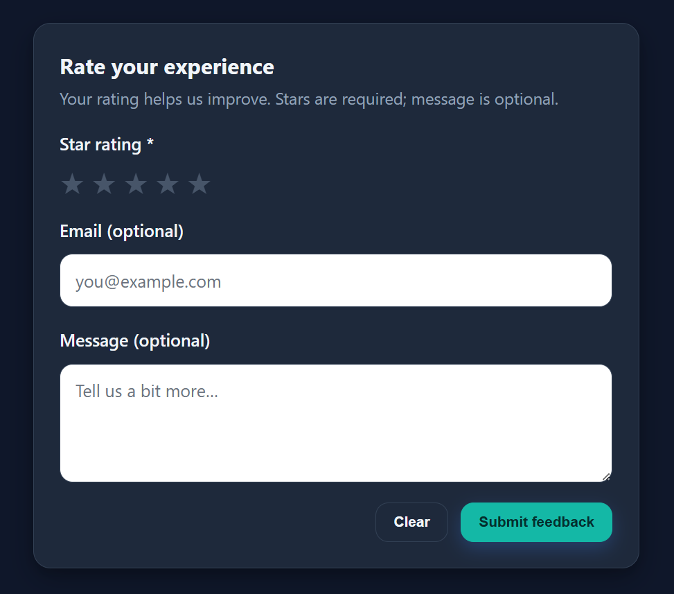
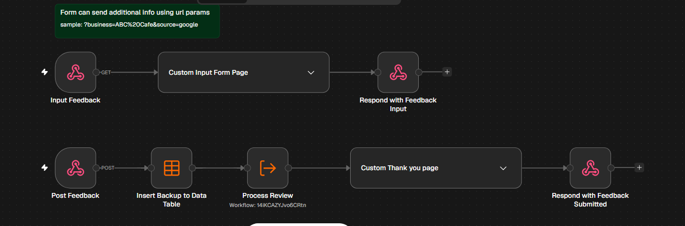
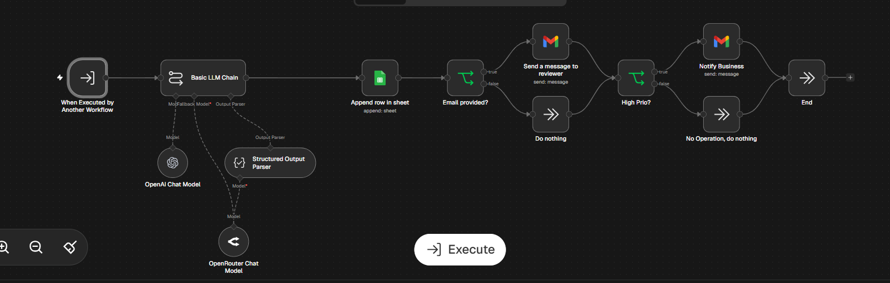
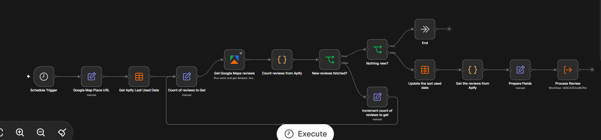

# AI-Powered Reputation Monitoring & Customer Insights

An n8n automation that collects customer feedback through online forms and Google Maps reviews, uses AI to analyze sentiment and identify recurring issues, stores structured results in Google Sheets, and delivers actionable insights to business owners through automated email reports.

## Problem Statement

Small and local businesses need to understand their customers' experiences to improve service quality, address complaints, and maintain a positive online reputation.

However, collecting feedback, monitoring public reviews, identifying recurring complaints, and organizing customer responses can be time-consuming when handled manually.

Customer feedback is often scattered across multiple channels. Businesses may miss valuable insights from direct customer submissions or overlook recurring issues hidden among numerous public reviews.

Without a consistent monitoring process, identifying emerging problems and understanding customer sentiment becomes more difficult.

## Solution

This project combines direct customer feedback collection with automated Google Maps review monitoring using n8n, Apify, and AI.

Customers can submit feedback through a custom online form, while a scheduled workflow retrieves recent Google Maps reviews for configured businesses.

The automation processes both sources to identify sentiment, categorize feedback, summarize customer experiences, and highlight potential issues requiring attention.

Duplicate detection and incremental processing help avoid repeatedly analyzing previously collected reviews. Processed results are stored in Google Sheets, providing a centralized record of customer feedback.

Automated email reports deliver relevant findings to business owners, helping them monitor customer sentiment, recognize recurring complaints, and make better-informed decisions without manually reviewing every submission.

## Workflow Screenshots

### 1. Custom Customer Feedback Form

### 2. Customer Feedback Collection Workflow

### 3. Customer Feedback Processor

### 4. Google Maps Reviews Collector

## Technology Stack

- **n8n** — Workflow automation and orchestration
- **Custom HTML Form** — Direct customer feedback collection
- **Apify** — Google Maps review collection
- **Google Sheets** — Centralized feedback storage and tracking
- **LLM API** — Sentiment analysis, feedback classification, and summarization
- **Email** — Automated customer responses and business reports

## Key Features

- **Direct Feedback Collection** — Collect customer ratings and optional written comments through an online form.
- **Google Maps Review Monitoring** — Periodically collect recent public reviews for configured businesses.
- **AI-Powered Sentiment Analysis** — Classify feedback as positive, neutral, or negative.
- **Feedback Categorization** — Organize customer comments into categories such as product quality, customer service, waiting time, cleanliness, and price/value.
- **Issue Identification** — Highlight complaints and potential problems that may require investigation.
- **Centralized Feedback Tracking** — Store structured feedback and analysis results in Google Sheets.
- **Duplicate Detection** — Identify previously processed reviews to reduce redundant analysis.
- **Incremental Processing** — Focus scheduled review collection on new or updated review data, according to the configured workflow logic.
- **Automated Email Reporting** — Deliver feedback summaries and relevant findings to business owners.
- **Customer Email Responses** — Generate AI-assisted responses to direct feedback when a customer provides an email address.
- **Reduced Manual Work** — Minimize the effort required to collect, organize, and analyze customer feedback.

## Expected Outcome

The automation provides business owners with a centralized view of customer feedback from direct submissions and public Google Maps reviews.

By identifying sentiment patterns, recurring complaints, and positive customer experiences, businesses can better understand customer needs, recognize potential service issues, and prioritize areas for improvement.

The result is a more consistent and efficient approach to reputation monitoring and customer insight generation, with less manual effort spent reviewing individual submissions.

## Limitations

- Google Maps review collection depends on the configured Apify actor, its capabilities, and applicable platform restrictions.
- AI-generated classifications and summaries may be imperfect and should be reviewed before making important business decisions.
- Customer email responses are generated from the submitted feedback and should not imply that an investigation, corrective action, or follow-up has occurred unless it has been confirmed.
- The automation monitors and analyzes reviews; it does not automatically post replies to Google Maps reviews.